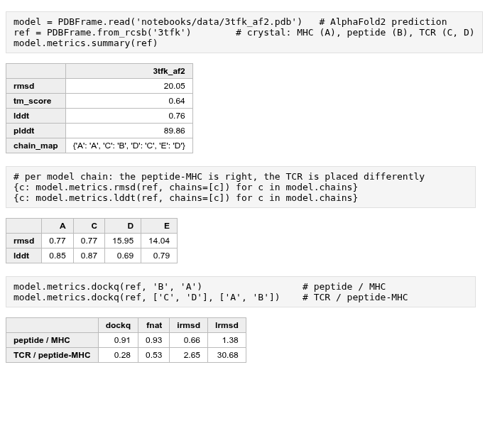
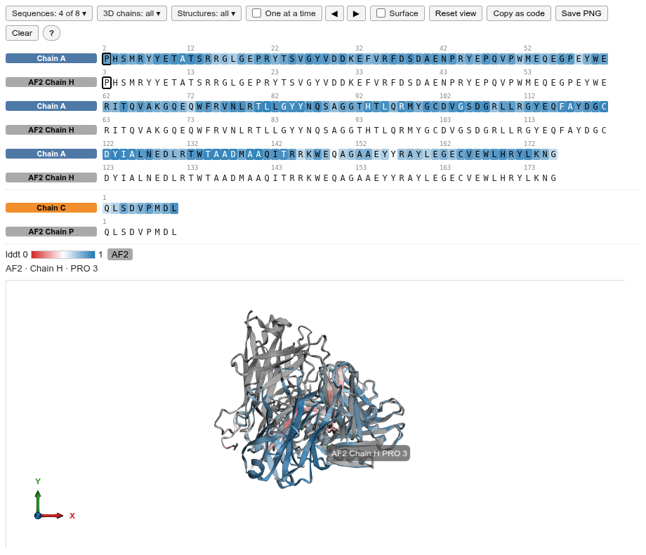

# PDBFrame

Protein structures and sequences as pandas tables. Read any common format or fetch from
the RCSB PDB, look inside (chains, residues, contacts), score a model against a reference,
and view it in 3D with its sequence. Use it as a Python library.

## What is it for?

1. **Analyze a structure.** One row per atom, and per residue, in a pandas DataFrame:
   chains, sequences, residues, selections, contacts and interfaces, with the residues
   an mmCIF file has no atoms for kept in their place.
2. **Score models against a reference.** RMSD, TM-score, lDDT, pLDDT and DockQ per
   interface. Chains are paired by sequence and residues by alignment, so the model's
   chain IDs and numbering don't need to match the reference's.
3. **See it.** An interactive 3D view next to each chain's sequence, with regions,
   interfaces, compared models or per-residue scores marked, saved as a standalone page.
4. **Compare sequences.** A sequence or an alignment as a per-position table, with
   identity, similarity and gap statistics.

## What it covers

| | function | what it does |
|---|---|---|
| **read** | `PDBFrame.read`, `PDBFrame.from_rcsb` | PDB, mmCIF, CSV or FASTA (gzipped too), or an entry or biological assembly from the RCSB PDB |
| **analyze** | `pf.df`, `pf.residues`, `pf.sequences`, `pf.unobserved` | atoms, residues (with the unobserved ones), sequences |
| | `pf.select`, `pf.near`, `pf.contacts` | atoms by chain, residue, atom name or mask; residues near others; residue contacts |
| | `pf.rename_chains`, `pf.renumber`, `pf + other` | editing; every method returns a new frame |
| **compare** | `pf.map_chains`, `pf.match`, `pf.superpose` | chains paired by sequence, common atoms, the best fit |
| | `pf.metrics.summary`, `.rmsd`, `.tm_score`, `.lddt`, `.dockq`, `.plddt` | scores against a reference |
| **view** | `pf.view()`, `pdbframe.view(...)` | 3D and sequence, linked; `.save('page.html')` |
| **write** | `pf.write` | PDB, mmCIF, CSV or FASTA by extension; mmCIF keeps the unobserved residues |
| **sequences** | `SeqFrame`, `SeqFrame.align`, `pf.seqframes()` | sequences and alignments as tables, `show()`, `statistics`, `pairwise()` |

## Install

```bash
pip install git+https://github.com/akdslab/PDBFrame.git
pip install 'pdbframe[view] @ git+https://github.com/akdslab/PDBFrame.git'   # also pf.py3Dmol()
```

`pf.view()` needs nothing extra; `[view]` adds py3Dmol, for `pf.py3Dmol()` views.

## A quick tour

`notebooks/data/` holds the crystal structure 3TFK (a T-cell receptor bound to a
peptide-MHC) and an AlphaFold2 model of it.

**What is in the file?**

```python
from pdbframe import PDBFrame

ref = PDBFrame.from_rcsb('3tfk')        # or PDBFrame.read('3tfk.cif')
ref        # PDBFrame '3TFK': 4 chains (A, B, C, D), 623 residues, 4972 atoms
ref.df                      # one row per atom: chain, residue, atom name, x, y, z, ...
ref.sequences['B']          # 'QLSDVPMDL', the peptide
ref.residues                # one row per residue, the unobserved ones too
#   chain  observed_index  residue_number  residue_name  aa  atoms  observed  full_index
#       A            <NA>               0           MET   M      0     False           1
#       A            <NA>               1           GLY   G      0     False           2
#       A               1               2           PRO   P      7      True           3
len(ref.unobserved)         # 21 residues of the deposited sequence have no atoms
```

**Select and find contacts**

```python
peptide = ref.select(chains='B')
ref.near(peptide, cutoff=4.0)           # whole residues within 4 Å of the peptide
ref.contacts(cutoff=4.0)                # residue pairs between chains, closest distance
#   chain_1  residue_number_1  residue_name_1  chain_2  residue_number_2  residue_name_2  distance
#         A                45             TYR        B                 2             LEU      3.83
#         A                62             ARG        B                 1             GLN      2.81
```

**Score a model.** Chains are paired by sequence (here the model's A, C, D, E are the
reference's A, B, C, D):

```python
model = PDBFrame.read('notebooks/data/3tfk_af2.pdb')
model.metrics.summary(ref)
# rmsd        20.05     Cα, whole complex
# tm_score     0.643
# lddt         0.757
# plddt       89.86
model.metrics.dockq(ref, 'B', 'A')      # the peptide-MHC interface
# {'dockq': 0.914, 'fnat': 0.930, 'irmsd': 0.658, 'lrmsd': 1.383, ...}
```

The peptide-MHC is right, but the TCR sits elsewhere, so the whole-complex RMSD is large.



**See it**

```python
ref.view(compare={'AF2': model})        # in a notebook; .save('page.html') for a page
```

Hover a residue in the 3D view or the sequence to light it up in both.



**Sequences and alignments**

```python
from pdbframe import SeqFrame

cdr3 = SeqFrame.align('CASSIRSSYEQYF', 'CASSIRSAYEQYF', 'CASSLGQAYEQYF', 'CASSIRSSGYEQYF',
                      names=['tcr1', 'tcr2', 'tcr3', 'tcr4'])
cdr3.show(reference='tcr1')      # '.' where a residue is the same as tcr1's
cdr3.statistics                  # identity, similarity, coverage, gaps
```

```
tcr1     1 CASSIRSS-YEQYF 13
tcr2     1 .......A-..... 13
tcr3     1 ....LGQA-..... 13
tcr4     1 ........G..... 14
           ||||:... |||||
```

A structure gives its chains as SeqFrames with `pf.seqframes()` (`full=True`: with the
unobserved residues), and `PDBFrame.read('in.pdb').write('out.fasta')` converts it to FASTA.

## Learn more

* [docs/pdbframe.md](docs/pdbframe.md): every method and option of `PDBFrame`, including
  unobserved residues and subclassing.
* [docs/seqframe.md](docs/seqframe.md): `SeqFrame`, alignments and their statistics.
* Notebooks: [pdbframe_example](notebooks/pdbframe_example.ipynb) (structures, selection,
  metrics, RCSB, FASTA), [pdbframe_display](notebooks/pdbframe_display.ipynb) (the
  viewers), [seqframe_example](notebooks/seqframe_example.ipynb) (sequences and
  alignments).
* **Claude Code.** The docs and four skills (analyzing a structure, comparing models, 3D
  views, aligning sequences) come with the package: `pdbframe docs seqframe` prints a
  page, and `pdbframe skills install` (`--project`: `./.claude/skills`) copies the skills
  into `~/.claude/skills`.
* Built on PDBFrame: [tcrstruct](https://github.com/akdslab/tcr-struct-bench), for
  TCR-pMHC structures.

## Data sources

- `3tfk_rcsb.pdb`, `3TFK.fasta`: PDB [3TFK](https://www.rcsb.org/structure/3TFK)
  ([Adams et al. 2011](https://doi.org/10.1016/j.immuni.2011.09.013)), via the
  [RCSB PDB](https://doi.org/10.1093/nar/28.1.235).
- `3tfk_af2*.pdb`: [AlphaFold2](https://doi.org/10.1038/s41586-021-03819-2) models of 3TFK.
- `aurka_tpx2_af3.cif`: [AlphaFold 3](https://doi.org/10.1038/s41586-024-07487-w) model from
  AlphaFold Server, unmodified; under the
  [AlphaFold Server Output Terms](https://alphafoldserver.com/output-terms), non-commercial use only.

## License

[MIT](LICENSE). The data files keep their sources' terms (above).

## Development

```bash
git clone https://github.com/akdslab/PDBFrame.git && cd PDBFrame
uv sync
uv run pytest
```

Changes are in [CHANGELOG.md](CHANGELOG.md).
